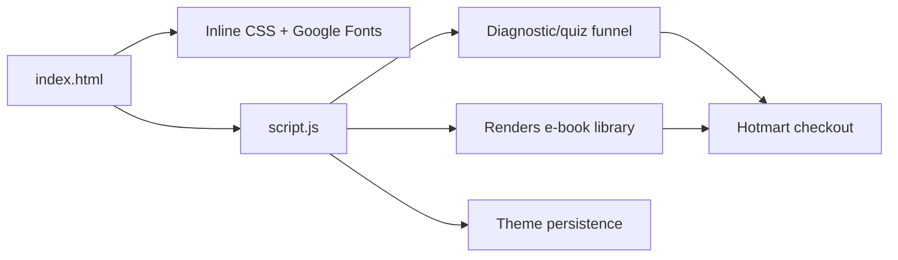

# KODAROS · Official landing page

**English** · [Português (Brasil)](README.md)

[](#) [](#) [](#) [](#) [](LICENSE)

## What it is

The official landing page for **KODAROS**, the digital-products brand of Kelvin Oliveira. The page showcases the e-book store, the KodaGrid software and the software, website and video services, and ends with an interactive diagnostic funnel that recommends the right offer for each visitor.

It is a static landing page: **no framework, no build step, no backend**. Everything runs in the browser from `index.html` and `script.js`.

## Status

In production. Published at <https://kelvinoliveiracode.github.io/kodaros-landing/> (HTTP 200 verified).

## Features

- **Showcase of 8 e-books** sold through Hotmart, filterable by level (beginner / intermediate / advanced), with a detail view.
- **Interactive diagnostic** (quiz): asks about the business profile and runs 3 tailored questions; at the end it reveals the result, offers the `do-zero-ao-patrimonio.pdf` e-book (42 pages) for free, and suggests the best-matching offer.
- **Service sections**: Software & Apps, Websites, Videos and Ads, Tools and Library, each with a buy CTA and WhatsApp.
- **KodaGrid**: a dedicated section for the spreadsheet builder with live formulas for Windows (offline), with a purchase link.
- **Contact form** and a floating WhatsApp button.
- **Light/dark mode** and a theme palette persisted via `localStorage`.
- **SEO**: `sitemap.xml`, `robots.txt`, Open Graph, Twitter Cards, JSON-LD (Organization and FAQPage) and a canonical link.
- **PWA manifest** (`site.webmanifest`) with 192/512 icons and a dark theme. (The page registers no service worker; it is only installable as a shortcut.)

## Architecture

A single HTML page (`index.html`) holds the full structure and the inline styles, plus a `script.js` for the logic. There are no modules and no bundler.



## Stack

- HTML5, CSS3 (variables in `oklch` and `color-mix`), no framework
- Vanilla ES6+ JavaScript (`script.js`, 776 lines)
- Google Fonts: Figtree, Instrument Serif and JetBrains Mono
- Hosting: GitHub Pages

## Repository layout

```
kodaros-landing/
├── index.html          # full landing (structure + inline CSS)
├── script.js           # logic: library, quiz, theme, contact
├── privacidade.html    # privacy page
├── termos.html         # terms of use
├── do-zero-ao-patrimonio.pdf  # free e-book from the diagnostic
├── *.webp / *.png / *.jpg     # images (covers, artwork)
├── site.webmanifest    # PWA manifest
├── sitemap.xml         # sitemap for indexing
├── robots.txt
└── LICENSE             # MIT
```

## Prerequisites and installation

None. Just serve the folder statically.

## How to run

```bash
# option 1: open directly in the browser
# open index.html

# option 2: local server
python -m http.server 8080
# go to http://localhost:8080
```

## Tests and quality

There are no automated tests in this repository (the absence of a test folder and of `package.json` is confirmed). There is no CI pipeline.

## Technical decisions and trade-offs

- **A single HTML with inline CSS instead of separate assets**: fewer requests and simpler deployment on static hosting; the trade-off is a large file (~129 KB).
- **Browser-side interaction with no backend**: the quiz and the showcase depend on no server. The final conversion happens on Hotmart, which processes payment and delivery.
- **Duplicated WebP/PNG**: each artwork ships a `.webp` (light) version and a `.png`/`.jpg` (fallback), a manual choice for compatibility.

## Known limitations and roadmap

- With no service worker registered, the PWA install does not enable full offline use.
- The page depends on Google Fonts; offline, the typography falls back to local fonts.
- The checkout is external (Hotmart); the landing has no cart of its own.

## Development process

An individual project by Kelvin Oliveira, built with orchestrated AI agents and reviewed by the author. The page architecture, the visual identity (oklch tokens) and the maintenance are the author's.

## License and author

MIT · Copyright (c) 2026 Kelvin Rebelo de Oliveira.

**Author**: [Kelvin Oliveira](https://github.com/KelvinOliveiraCode) · [Portfolio](https://kelvinoliveiracode.github.io/portfolio/)
