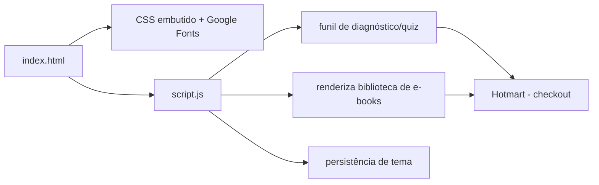

# KODAROS — Landing page oficial

[English](README.en.md) · **Português (Brasil)**

[](#) [](#) [](#) [](#) [](LICENSE)

## O que é

Landing page oficial da **KODAROS** — a marca de produtos digitais de Kelvin Oliveira. A página apresenta a loja de e-books, o software KodaGrid e os serviços de software, sites e vídeos, e termina com um funil de diagnóstico interativo que recomenda a oferta certa para cada visitante.

É uma landing estática: **sem framework, sem build, sem backend**. Todo o conteúdo roda no navegador a partir de `index.html` e `script.js`.

## Status

Em produção. Publicada em <https://kelvinoliveiracode.github.io/kodaros-landing/> (HTTP 200 verificado).

## Funcionalidades

- **Vitrine de 8 e-books** vendidos via Hotmart, com filtro por nível (iniciante / intermediário / avançado) e página de detalhe.
- **Diagnóstico interativo** (quiz): pergunta o perfil do negócio e aplica 3 perguntas adaptadas; ao final revela o resultado e oferece o e-book brinde `do-zero-ao-patrimonio.pdf` (42 páginas) grátis, além de sugerir a oferta mais aderente.
- **Seções de serviços** — Softwares & Apps, Sites, Vídeos e Propagandas, Ferramentas e Biblioteca — com CTA de compra e WhatsApp.
- **KodaGrid**: seção dedicada ao construtor de planilhas com fórmulas para Windows (offline), com link de compra.
- **Formulário de contato** e botão flutuante de WhatsApp.
- **Modo claro/escuro** e paleta de temas com persistência via `localStorage`.
- **SEO**: `sitemap.xml`, `robots.txt`, Open Graph, Twitter Cards, JSON-LD (Organization e FAQPage) e link canônico.
- **PWA manifest** (`site.webmanifest`) com ícones 192/512 e tema escuro. (A página não registra service worker; é instalável apenas como atalho.)

## Arquitetura

Uma única página HTML (`index.html`) com toda a estrutura e o estilo embutidos, mais um `script.js` para a lógica. Sem divisão em módulos nem bundler.



## Stack

- HTML5, CSS3 (variáveis em `oklch` e `color-mix`) — sem framework
- JavaScript ES6+ vanilla (`script.js`, 776 linhas)
- Google Fonts: Figtree, Instrument Serif e JetBrains Mono
- Hospedagem: GitHub Pages

## Estrutura do repositório

```
kodaros-landing/
├── index.html          # landing completa (estrutura + CSS embutido)
├── script.js           # lógica: biblioteca, quiz, tema, contato
├── privacidade.html    # página de privacidade
├── termos.html         # termos de uso
├── do-zero-ao-patrimonio.pdf  # e-book brinde do diagnóstico
├── *.webp / *.png / *.jpg     # imagens (capas, covers, arte)
├── site.webmanifest    # manifesto PWA
├── sitemap.xml         # sitemap para indexação
├── robots.txt
└── LICENSE             # MIT
```

## Pré-requisitos e instalação

Nenhum. Basta servir a pasta estaticamente.

## Como executar

```bash
# opção 1: abrir direto no navegador
# abra index.html

# opção 2: servidor local
python -m http.server 8080
# acesse http://localhost:8080
```

## Testes e qualidade

Não há testes automatizados neste repositório (ausência de pasta de testes e de `package.json` confirmada). Não há pipeline de CI.

## Decisões técnicas e trade-offs

- **Um único HTML com CSS embutido em vez de assets separados**: reduz requisições e simplifica deploy em hospedagem estática; em troca, o arquivo fica grande (~129 KB).
- **Interação no navegador sem backend**: o quiz e a vitrine não dependem de servidor. A conversão final acontece na Hotmart, que processa pagamento e entrega.
- **WebP/png duplicados**: cada arte tem versão `.webp` (leve) e `.png/.jpg` (fallback), escolha manual para compatibilidade.

## Limitações conhecidas e roadmap

- Sem registro de service worker, a instalação PWA não habilita uso offline completo.
- A página depende de Google Fonts; sem rede a tipografia cai para fontes locais de fallback.
- O checkout é externo (Hotmart); a landing não tem carrinho próprio.

## Processo de desenvolvimento

Projeto individual de Kelvin Oliveira, construído com agentes de IA orquestrados e revisado pelo autor. A arquitetura da página, a identidade visual (tokens oklch) e a manutenção são do autor.

## Licença e autor

MIT — Copyright (c) 2026 Kelvin Rebelo de Oliveira.

**Autor**: [Kelvin Oliveira](https://github.com/KelvinOliveiraCode) · [Portfólio](https://kelvinoliveiracode.github.io/portfolio/)
